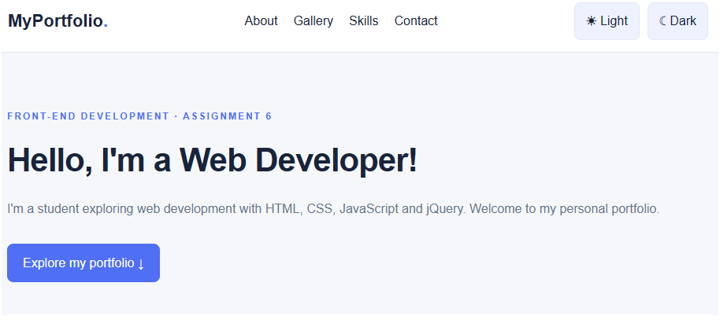
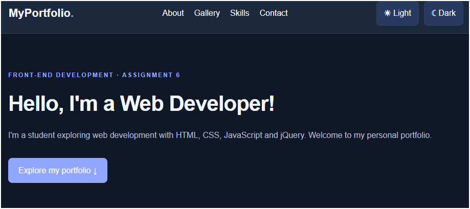
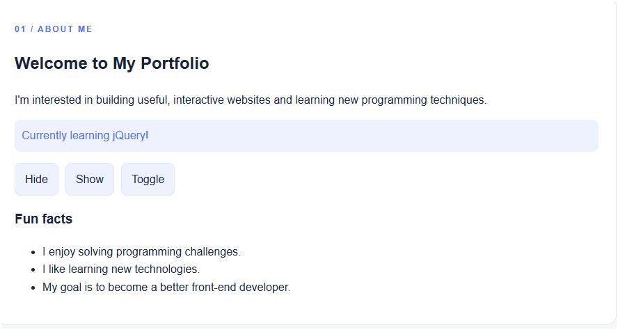
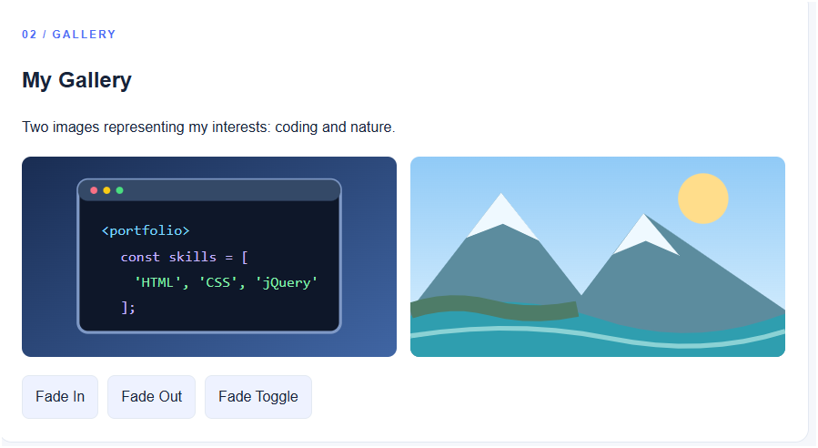
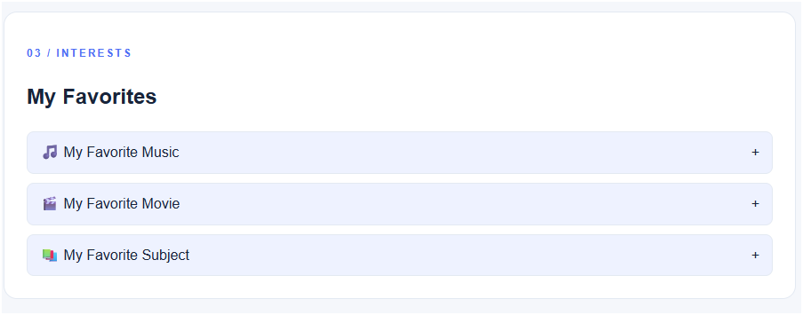
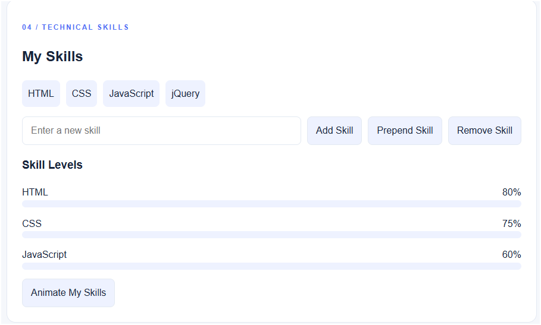
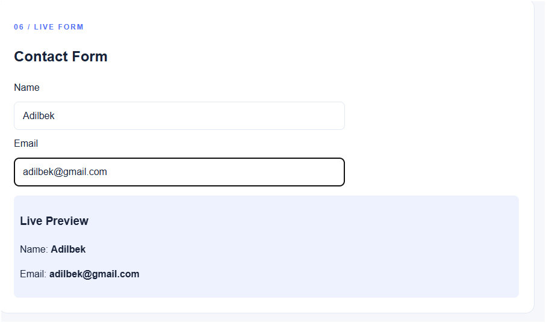
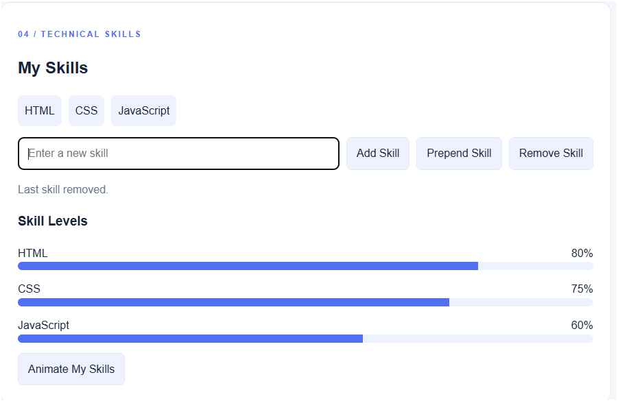

# Assignment 6 — jQuery Personal Portfolio

**Student Name:**  Nazhim Adilbek
**Group:** SE-2539

## Overview
A responsive personal portfolio built using HTML, CSS, JavaScript, and jQuery 3.7.1. The project demonstrates selectors, effects, DOM manipulation, attributes, live form interaction, and animations.

## Tasks

### Task 0 — Setup
Load jQuery through a CDN, run `$(document).ready(...)`, and print `jQuery is ready!` in the browser console.

### Task 1 — Selectors & CSS
Show a personal greeting and introduction. Use tag, ID and class selectors; update content with `.text()` and `.html()`, style an element with `.css()`, and switch light/dark themes.

### Task 2 — Visibility Methods
Display About Me, status and fun facts. Control visibility using `.hide()`, `.show()` and `.toggle()`.

### Task 3 — Fade Methods
Show two gallery images. Apply `.fadeIn()`, `.fadeOut()` and `.fadeToggle()`.

### Task 4 — Slide Methods
Create three expandable interest panels using `.slideUp()`, `.slideDown()` and `.slideToggle()`.

### Task 5 — Add & Remove Elements
Start with four skills. Use `.append()`, `.prepend()` and `.remove()` to manage the list; reject blank entries.

### Task 6 — Modifying Attributes
Switch a social link between GitHub and LinkedIn using `.attr()`.

### Task 7 — Form Interaction
Display Name and Email input values immediately with `.val()` and `.text()`.

### Task 8 — Basic Animation
Animate three skill bars from zero width to different percentages and back using `.animate()`.

## Work Process Summary
I created the HTML structure, added responsive CSS styling, connected jQuery through a CDN, and implemented all nine tasks using jQuery selectors, event handlers, effects and animations. I checked the interface in a browser and prepared documentation for the assignment.

